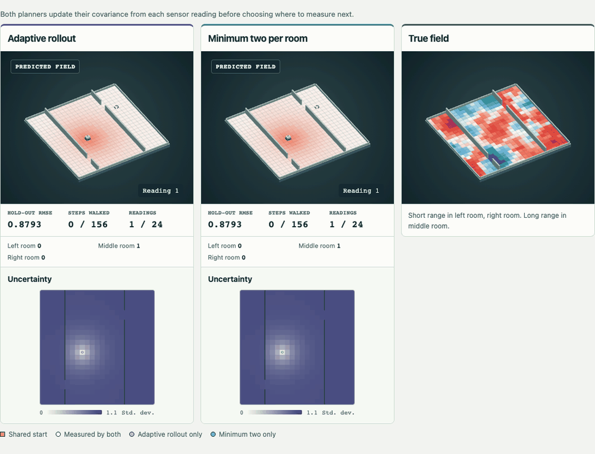

# Field Routes · Spatial Exploration AI

**Where should a robot take its next reading?** Field Routes simulates a robot mapping an unknown sensor field inside a known floor plan. It can walk through doors and collect noisy readings along the way. The goal is to reconstruct the field as accurately as possible within the travel and sensing limits.

**[Launch the interactive demo](https://hwanggwan.github.io/spatial-exploration-ai/#room-coverage-row)** · [Benchmark results](#what-we-found) · [Reproduce the demo](#reproduce-the-benchmark)

[](https://hwanggwan.github.io/spatial-exploration-ai/#room-coverage-row)

Both planners update the spatial covariance from their sensor readings before choosing where to measure next. One planner also reserves enough budget to measure at least two distinct sites in each room. In the opening replay, both start at the same point, walk **156 steps**, and take **24 readings**. Drag the timeline to see how their routes, predictions, and uncertainty evolve alongside the true field. [Standalone HTML](demo/index.html)

The two adaptive replays show selected fields where the room requirement improves both error measures. The floor-plan selector also includes the earlier corridor replay, which uses fixed range weights for planning. [Three rooms in a row](https://hwanggwan.github.io/spatial-exploration-ai/#room-coverage-row) · [Four-room loop](https://hwanggwan.github.io/spatial-exploration-ai/#room-coverage-loop) · [Corridor](https://hwanggwan.github.io/spatial-exploration-ai/#room-coverage-corridor)

## What we found

**Requiring two readings per room slightly lowers mean map error in both layouts.** We compared both adaptive planners over **10,240 paired field and start combinations**, with shared caps of 156 steps and 24 readings. Each pair is scored on the same cells that neither route measured. The table reports the share of pairs where the requirement lowers RMSE and the mean change in RMSE.

| Floor plan | Dependence across walls | Whole-map win rate | Short-range win rate | Mean RMSE change, whole / short |
| --- | --- | ---: | ---: | ---: |
| Three rooms in a row | Weak | 53.7% | 54.0% | −0.0089 / −0.0128 |
| Four-room loop | Weak | 34.7% | 33.6% | −0.0045 / −0.0040 |
| Three rooms in a row | Strong | 54.7% | 53.1% | −0.0088 / −0.0082 |
| Four-room loop | Strong | 34.9% | 33.6% | −0.0046 / −0.0050 |

In the loop, the policies measure identical sites in about 37% of pairs and obtain the same RMSE. Among weak-wall pairs that measure different sites, the loop win rates are 54.8% and 53.0%. In the row layout, requiring two readings removes the 44 coverage misses seen in 3,072 unconstrained runs. Both layouts also show lower mean errors among route pairs that use all 156 steps and all 24 readings. [Protocol and paired results](docs/residential-floor-plan-study.md#updating-the-planning-covariance-at-each-reading)

### Earlier benchmarks

On the corridor layouts with fixed range weights for planning, allowing more walking improved map accuracy under the 24-reading cap. The 52-, 104-, and 156-step results cover 448 paired fields. [Corridor budget study](docs/residential-floor-plan-study.md#increasing-the-walking-budget-with-a-fixed-reading-cap)

On three unequal rooms, **priority allocation mapped the field more accurately than equal allocation while walking less**. Rollout had the lowest error at the shared budget cap and still improved on priority allocation when limited to the same actual walking distance.

| Planner | Held-out RMSE ↓ | Actual distance | Mean readings | Planning time |
| --- | ---: | ---: | ---: | ---: |
| Equal allocation | 0.7834 | 2.080 | 16.00 | ≈4 ms |
| Priority allocation | 0.7470 | 1.886 | 15.88 | ≈4 ms |
| Rollout | **0.6835** | 2.364 | 16.00 | ≈670 ms |
| Rollout capped at priority's distance | 0.7331 | 1.886 | 16.00 | ≈450 ms |

*Means over 256 paired synthetic fields where walls weaken spatial dependence, on two floor plans with four starts each. The first three planners share a 16-reading cap and a travel cap of 2.364 map-side units. RMSE is computed on 28 fixed sites that the robot never measures. Times cover planning a route on one CPU thread. The screenshot shows one scene; the table summarizes the benchmark.*

At matched travel distance, rollout lowered RMSE by **1.9%** versus priority allocation (paired difference −0.0139, 95% interval [−0.0248, −0.0037]). It also took slightly more readings on average. In [two equal-sized rooms](docs/wall-room-quota-study.md), a cheap room quota and distance-matched rollout had similar whole-map error, though rollout did better near the wall. The benefit of looking ahead depends on the layout and which parts of the map matter.

## Learned world model

A [learned sensing model](docs/sensing-world-study.md) fits a mixture of spatial covariance models to offline simulated sensor data. During exploration it infers the current pattern from readings and considers how possible next readings would update both its map and its next decision. With the two-step planner, the learned model lowers held-out RMSE versus GP rollout at 18 edges. With a full-budget rollout, it also lowers mean error in both 26-edge conditions, where both rollout policies use the full travel budget.

## How it works

The robot knows **where it can move**, but has to measure **what the sensor reads**. It travels along the shortest legal grid path between stops. A [Bayesian ridge model](src/spatial_exploration/basis_bayes.py) combines coordinate-based features with graph heat features that reflect walls and doorways, then updates its prediction and uncertainty from the readings taken so far.

The three Bayesian planners share that mapper:

| Planner | How it chooses readings |
| --- | --- |
| **Equal allocation** | Divides readings evenly across selected rooms and favors feasible plans that collect more readings. |
| **Priority allocation** | Gives more readings to rooms with more remaining uncertainty and lower entry cost, while reserving enough distance to reach them. |
| **Rollout** | Tries each feasible next stop, simulates a greedy route to the end of the budget, and chooses the move with the lowest predicted final map variance. |

The 156-step adaptive planners use a shared mixture of spatial covariance models. With each sensor reading, they update the probabilities of the range patterns and condition the resulting covariance on the sites visited so far. The rollout evaluates possible continuations with that covariance and executes the first move. The 3D demo replays those decisions with the simulator's true field shown for scoring and display.

## Reproduce the benchmark

Use Python 3.12 from the repository root. These commands regenerate the frozen mapper settings, run the three-room comparison, and rebuild the offline demo. Use fresh output directories when rerunning the studies.

```sh
python3.12 -m venv .venv
source .venv/bin/activate
python -m pip install -e '.[neural]'
python -m spatial_exploration.wall_topology_study --output outputs/wall-topology-study
python -m spatial_exploration.three_room_study --output outputs/three-room-study
python -m spatial_exploration.sensing_world_study
python -m spatial_exploration.sensing_world_study --full-rollout
python tools/build_three_room_demo.py
python -m unittest discover -s tests -v
```

The demo notes cover the adaptive and fixed-weight replay archives. The experiment index covers earlier GP and DeepKriging comparisons, learned planning, and reproduction notes. [Demo notes](demo/README.md) · [Three-room report](docs/three-room-study.md) · [Experiment index](docs/experiments.md)
