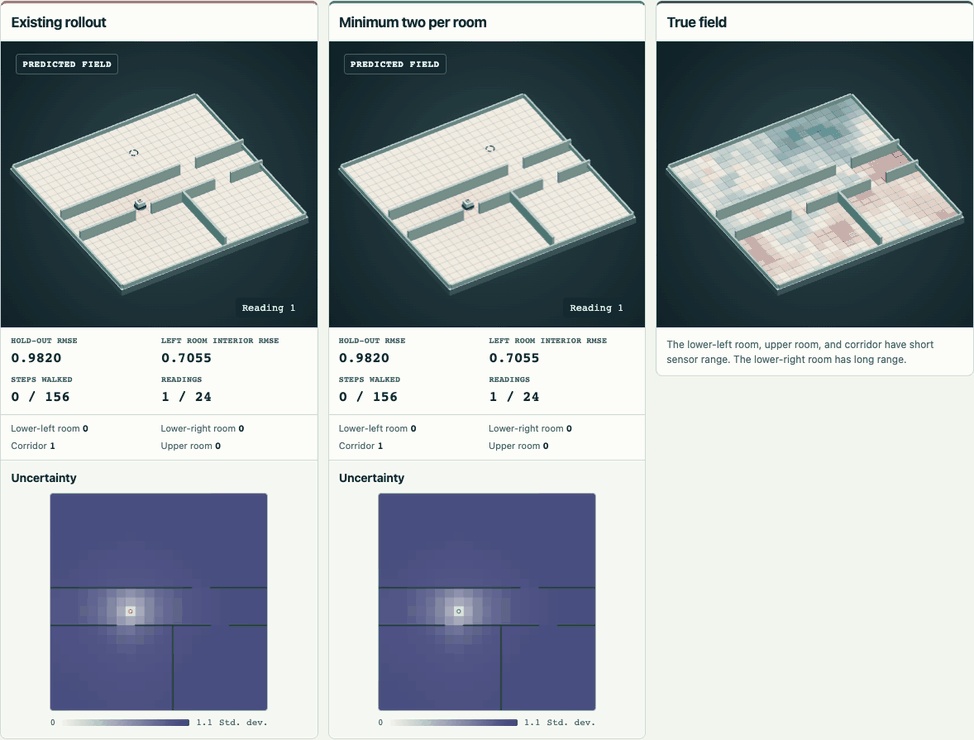

# Field Routes · Spatial Exploration AI

**Where should a robot take its next reading?** Field Routes simulates a robot mapping an unknown sensor field inside a known floor plan. It can walk through doors and collect noisy readings along the way. The goal is to reconstruct the field as accurately as possible within the travel and sensing limits.

**[Launch the interactive demo](https://hwanggwan.github.io/spatial-exploration-ai/#room-coverage)** · [Benchmark results](#what-we-found) · [Reproduce the demo](#reproduce-the-benchmark)

[](https://hwanggwan.github.io/spatial-exploration-ai/#room-coverage)

The opening replay compares the existing rollout with a policy that measures at least two distinct sites in each room. Both robots walk **156 steps** and take **24 readings**. Move the timeline to see their predictions and uncertainty after each reading, with the true field alongside. The experiment selector also opens the earlier [52-step greedy comparison](https://hwanggwan.github.io/spatial-exploration-ai/#greedy-rollout). To use the demo offline, download and open the [standalone HTML](demo/index.html).

## What we found

**A room requirement improves coverage. Extra walking distance helps the robot reach useful sites inside those rooms.** Across eight layout/start pairs, the two-site requirement obtained at least two readings in every room on all eight 52-step routes, compared with zero of eight for the unconstrained rollout. At that budget, whole-map error was similar and short-zone error increased. At 104 and 156 steps, both map errors fell for both policies.

| Walking steps | Whole-map RMSE · existing / min. two | Short-zone RMSE · existing / min. two |
| ---: | ---: | ---: |
| 52 | 0.7435 / 0.7456 | 0.7977 / 0.8127 |
| 104 | 0.6622 / 0.6451 | 0.7353 / 0.7243 |
| 156 | 0.6259 / 0.6118 | 0.7030 / 0.6887 |

The table averages **448 paired synthetic fields** with short- and long-range zones and weak cross-wall dependence. All six policies share a 24-reading cap and are evaluated on cells unmeasured by all six routes. For the six starts where the minimum-two policy took exactly 24 readings at both 104 and 156 steps, the longer route lowered short-zone RMSE by **0.0396** (paired 95% interval [−0.0498, −0.0291]). At 156 steps, the comparison between policies on starts where both took 24 readings had a whole-map RMSE difference of −0.0031 [−0.0102, +0.0039]. [Protocol and paired results](docs/residential-floor-plan-study.md#increasing-the-walking-budget-with-a-fixed-reading-cap)

In the replayed field, the room requirement increased the lower-left room's readings from one to six. RMSE in that room's interior went from **0.877 to 0.541**, while whole-map RMSE went from **0.645 to 0.652**. [See the true field and close-up predictions](demo/room-coverage-maps.png).

### Earlier benchmarks

On three unequal rooms, **priority allocation mapped the field more accurately than equal allocation while walking less**. Rollout had the lowest error at the shared budget cap and still improved on priority allocation when limited to the same actual walking distance.

| Planner | Held-out RMSE ↓ | Actual distance | Mean readings | Planning time |
| --- | ---: | ---: | ---: | ---: |
| Equal allocation | 0.7834 | 2.080 | 16.00 | ≈4 ms |
| Priority allocation | 0.7470 | 1.886 | 15.88 | ≈4 ms |
| Rollout | **0.6835** | 2.364 | 16.00 | ≈670 ms |
| Rollout capped at priority's distance | 0.7331 | 1.886 | 16.00 | ≈450 ms |

*Means over 256 paired synthetic fields where walls weaken spatial dependence, on two floor plans with four starts each. The first three planners share a 16-reading cap and a travel cap of 2.364 map-side units. RMSE is computed on 28 fixed sites that the robot never measures. Times cover planning a route on one CPU thread. The screenshot shows one scene; the table summarizes the benchmark.*

At matched travel distance, rollout lowered RMSE by **1.9%** versus priority allocation (paired difference −0.0139, 95% interval [−0.0248, −0.0037]). It also took slightly more readings on average. In [two equal-sized rooms](docs/wall-room-quota-study.md), a cheap room quota and distance-matched rollout had similar whole-map error, though rollout did better near the wall. The benefit of looking ahead depends on the layout and which parts of the map matter.

## Learned world model

A [learned sensing model](docs/sensing-world-study.md) fits a mixture of spatial covariance models to offline simulated sensor data. During exploration it infers the current pattern from readings and considers how possible next readings would update both its map and its next decision. With the two-step planner, the learned model lowers held-out RMSE versus GP rollout at 18 edges. With a full-budget rollout, it also lowers mean error in both 26-edge conditions, where both rollout policies use the full travel budget.

## How it works

The robot knows **where it can move**, but has to measure **what the sensor reads**. It travels along the shortest legal grid path between stops. A [Bayesian ridge model](src/spatial_exploration/basis_bayes.py) combines coordinate-based features with graph heat features that reflect walls and doorways, then updates its prediction and uncertainty from the readings taken so far.

The three Bayesian planners share that mapper:

| Planner | How it chooses readings |
| --- | --- |
| **Equal allocation** | Divides readings evenly across selected rooms and favors feasible plans that collect more readings. |
| **Priority allocation** | Gives more readings to rooms with more remaining uncertainty and lower entry cost, while reserving enough distance to reach them. |
| **Rollout** | Tries each feasible next stop, simulates a greedy route to the end of the budget, and chooses the move with the lowest predicted final map variance. |

The demo replays verified routes, predictions, and hypothetical observation updates from the benchmarks. The Bayesian planners use uncertainty updated from the locations measured so far. The learned planner also uses the acquired values to update which spatial pattern it expects. The simulator's true field is used for scoring and display. The 3D scene renders the synthetic 2D benchmark's floor plan and recorded moves.

## Reproduce the benchmark

Use Python 3.12 from the repository root. These commands regenerate the frozen mapper settings, run the three-room comparison, and rebuild the offline demo. Use fresh output directories when rerunning the studies.

```sh
python3.12 -m venv .venv
source .venv/bin/activate
python -m pip install -e '.[neural]'
python -m spatial_exploration.wall_topology_study --output outputs/wall-topology-study
python -m spatial_exploration.three_room_study --output outputs/three-room-study
python -m spatial_exploration.sensing_world_study
python -m spatial_exploration.sensing_world_study --full-rollout
python tools/build_three_room_demo.py
python -m unittest discover -s tests -v
```

The [three-room report](docs/three-room-study.md) includes the full budget and field comparisons, room-level error, and route verification. The [demo notes](demo/README.md) list the additional commands for the 23 × 23 corridor scenes. The [experiment index](docs/experiments.md) covers earlier GP and DeepKriging comparisons, learned planning, and reproduction notes.
